# Lab 3: REST API, Query Parameters, Validation, Debugging

**Name:** N Dhivija  
**Registration Number:** 252U1R6112  
**Section:** S02

## 1. Project Description

This lab focuses on developing a REST API using Node.js, Express.js and SQLite. The application manages book records and supports retrieving, searching, sorting, filtering, adding, updating and deleting books.

## 2. Live Link

Not deployed yet. The application was tested locally using Postman.

**Local URL:** `http://localhost:3000/`

## 3. Technologies Used

- Node.js
- Express.js
- SQLite
- JavaScript
- Postman
- VS Code

## 4. Installation and Execution

### Install dependencies

```bash
npm install
```

### Start the server

```bash
node server.js
```

The server runs at:

```text
http://localhost:3000/
```

**Environment variable:** `PORT` (optional; defaults to 3000).

## 5. API Endpoints

| Method | Endpoint | Description |
|---|---|---|
| GET | `/books/` | Retrieve all books |
| GET | `/books/?search_q=value` | Search books by title |
| GET | `/books/?order_by=price&order=ASC` | Sort books |
| GET | `/books/?limit=5&offset=0` | Retrieve books using pagination |
| GET | `/books/?min_price=100&max_price=500` | Filter books by price |
| GET | `/books/:bookId/` | Retrieve a single book |
| POST | `/books/` | Add a new book |
| PUT | `/books/:bookId/` | Update an existing book |
| DELETE | `/books/:bookId/` | Delete a book |

## 6. Screenshots

All screenshots are stored in the `screenshots/` folder.

### GET Operations

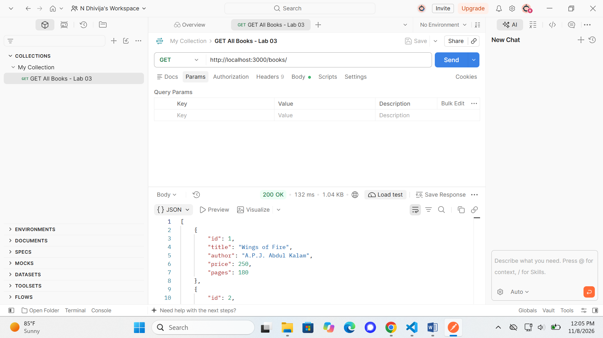

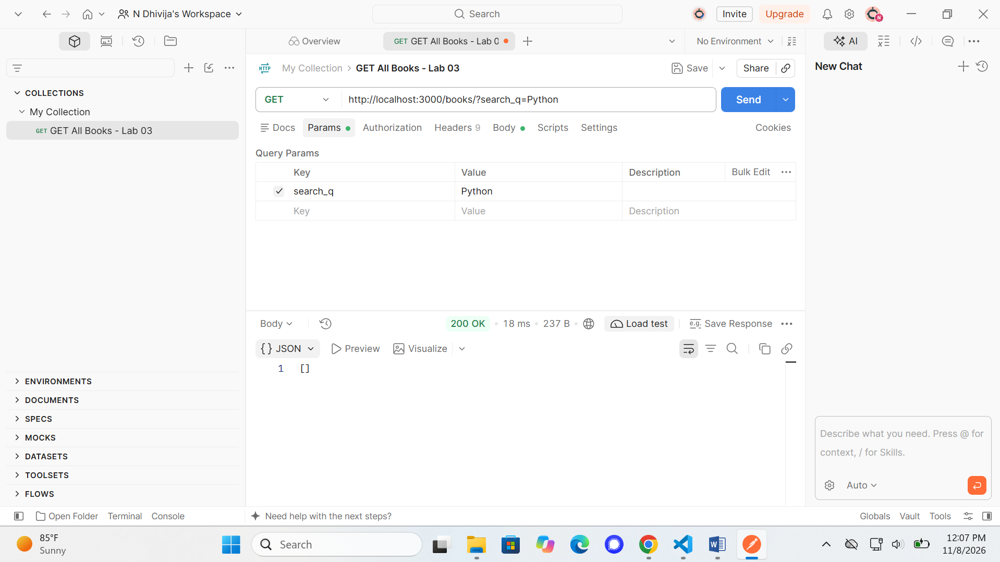

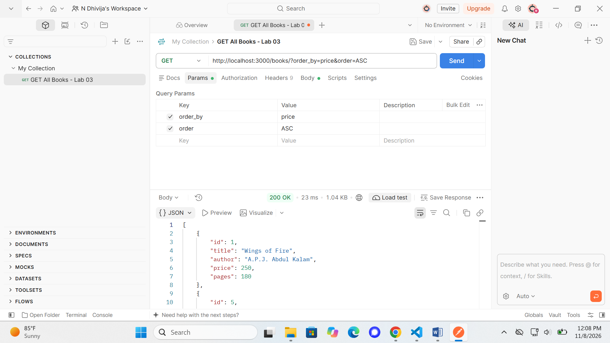

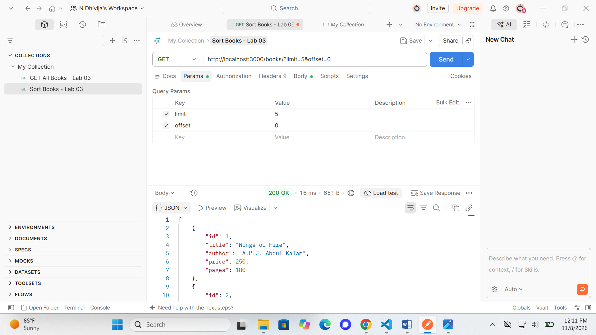

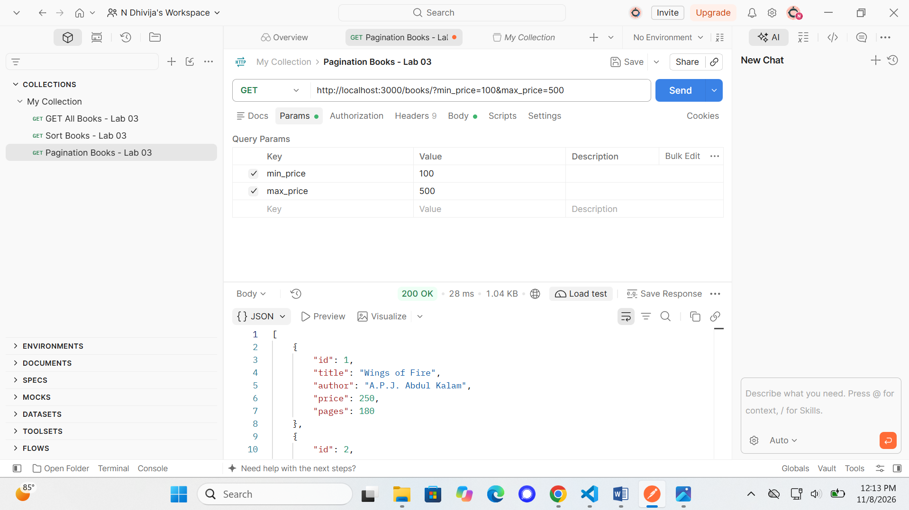

### POST Operations

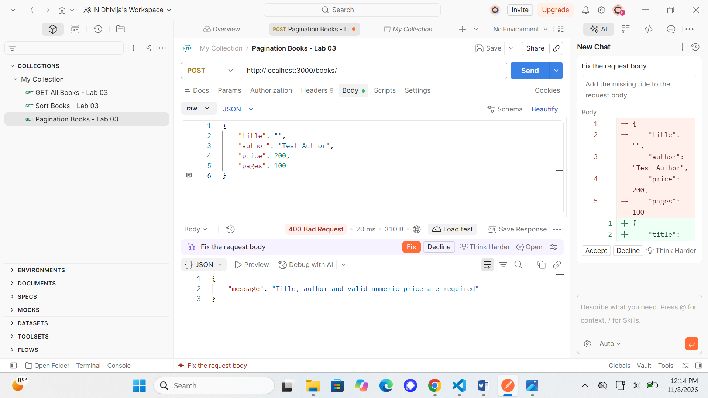

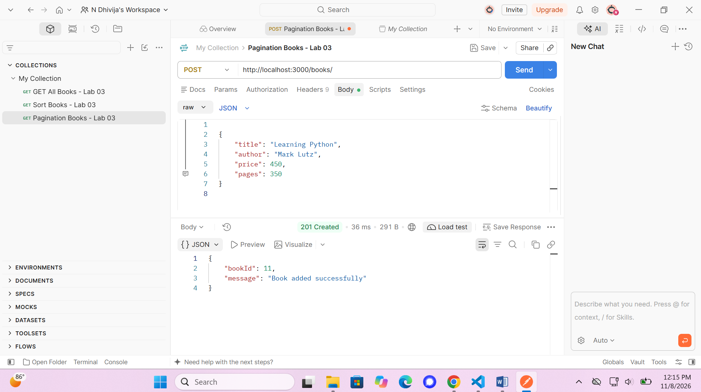

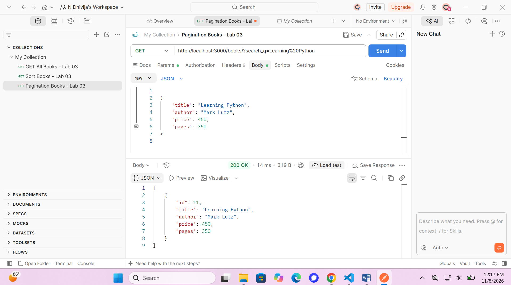

### PUT Operations

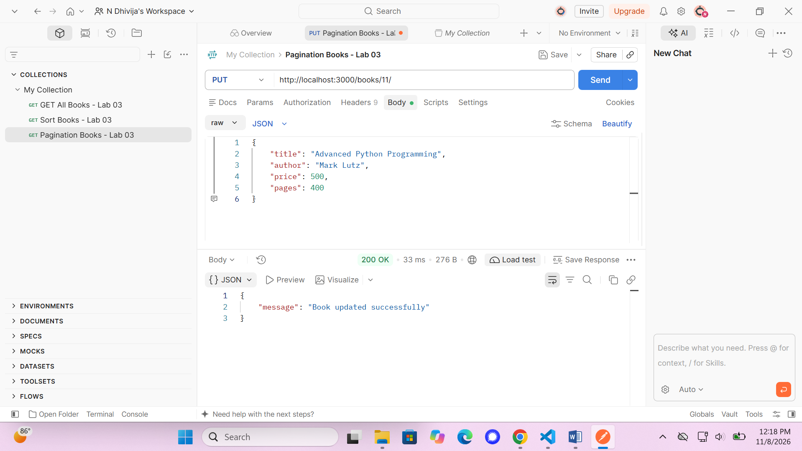

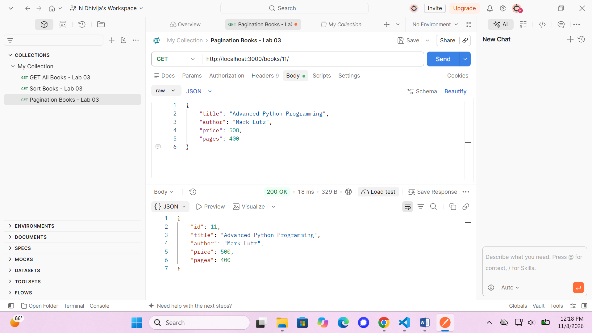

### DELETE Operations

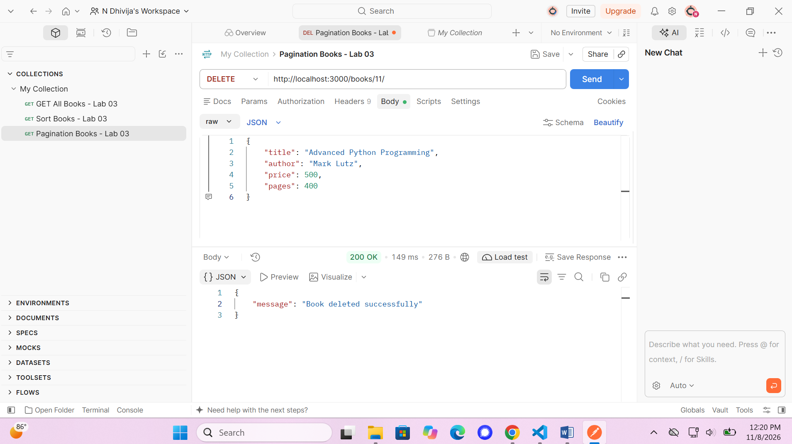

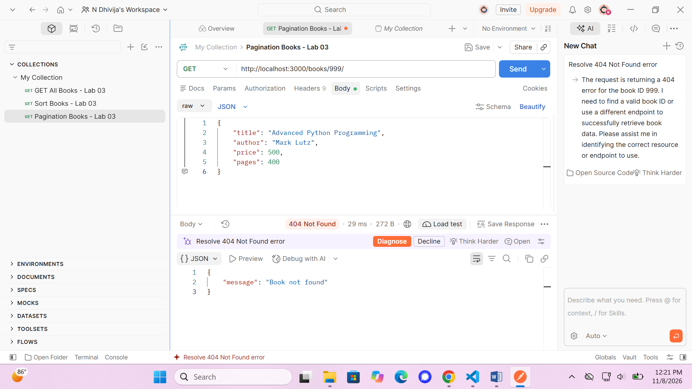

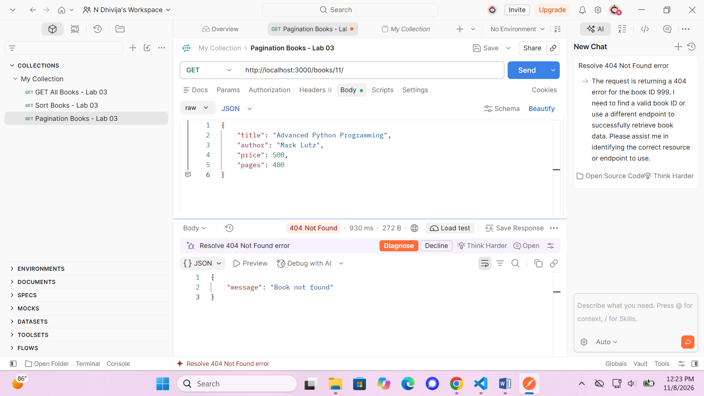

### Debugging Exercises

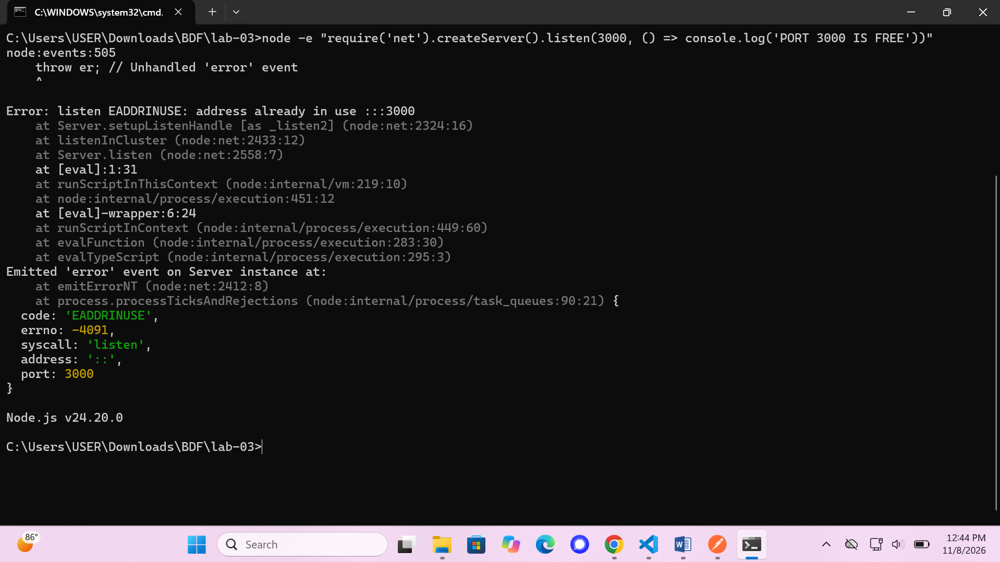

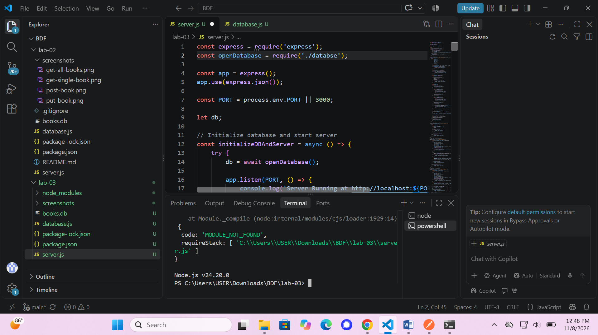

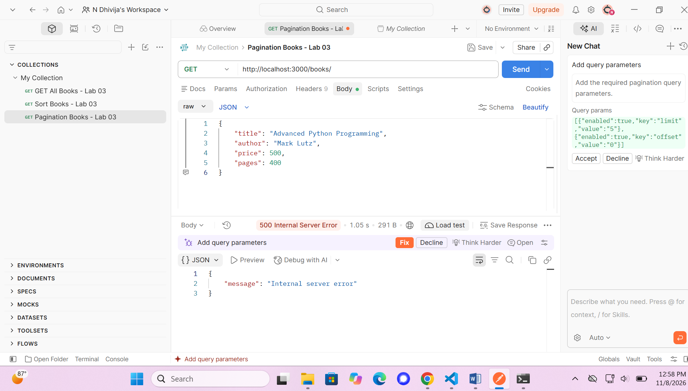

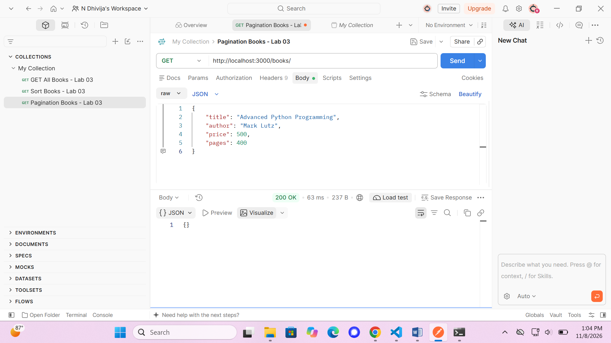

## 7. Challenges Faced

During this lab, I encountered errors such as port conflicts, incorrect import paths, table name mismatches and missing await statements. I resolved these errors by checking the running processes, correcting file paths, verifying SQL table names and using async/await properly.

## 8. Learning Outcomes

Through this lab, I learned how to develop REST APIs, handle HTTP methods, use query parameters, perform SQLite database operations, validate user input, implement pagination and filtering, and debug common backend development errors.